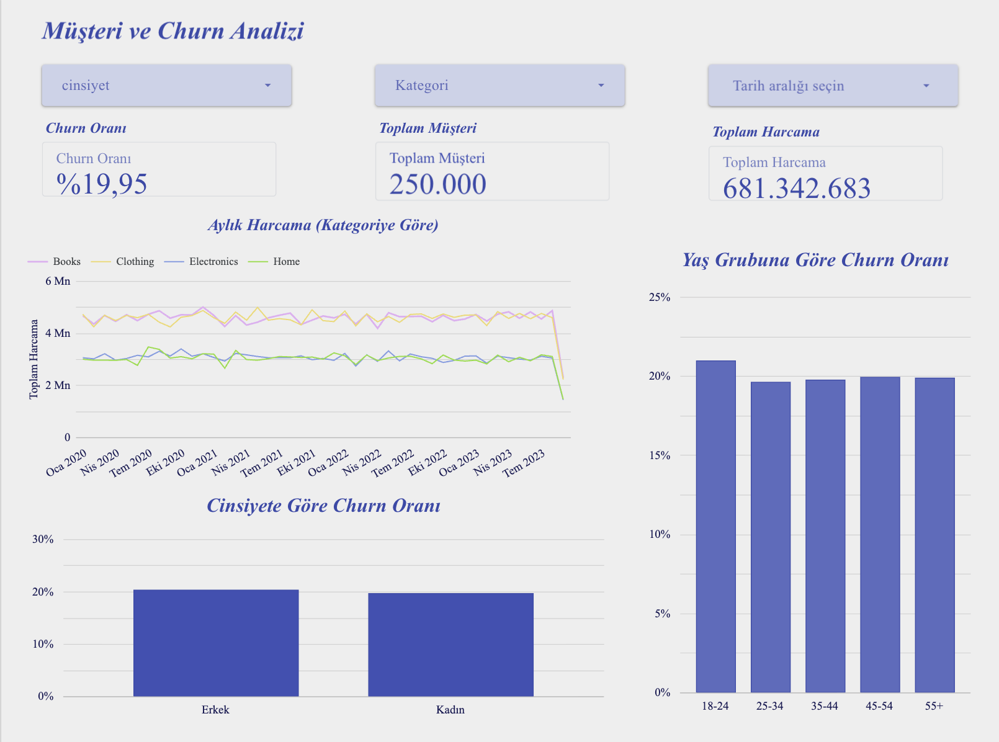
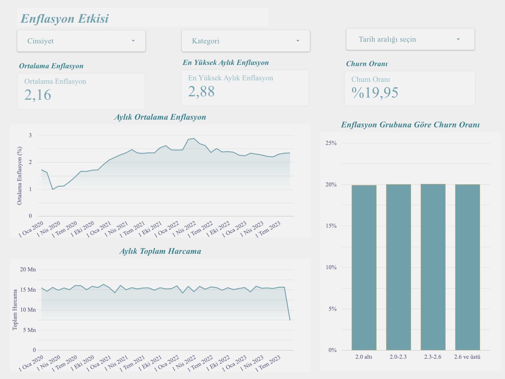
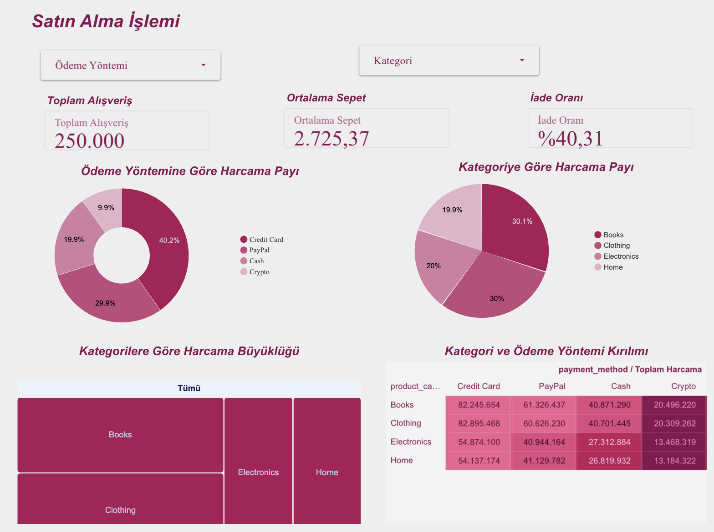

# E-Ticaret Müşteri Kaybı (Churn) ve Enflasyon Analizi

YBS İş Zekası ve Veri Madenciliği dersi dönem projesi.

Bu proje, bir e-ticaret şirketinin müşteri alışveriş geçmişini FRED enflasyon beklentisi verisiyle birleştirir. Amaç, müşteri kaybının (churn), harcamanın ve satın alma davranışının enflasyon dönemleriyle ve müşteri özellikleriyle ilişkisini incelemektir. Veri, dbt ve DuckDB ile hazırlanır, sonuçlar Looker Studio dashboard'unda sunulur.

**Dashboard (Looker Studio):** [Raporu aç](https://datastudio.google.com/reporting/6a04596f-32f7-4332-a4a5-c3d2792313ce)

> Raporu açmak için Google hesabıyla giriş yapmak gerekebilir.

## Proje amacı

1. Alışveriş ve enflasyon verisini temizlemek, birleştirmek ve dbt ile analiz tabloları (staging ve marts) oluşturmak.
2. Modelleri test etmek ve belgelemek (testler, dbt docs, veri sözlüğü).
3. Müşteri kaybını, enflasyonun etkisini ve satın alma davranışını üç sayfalık bir dashboard'da sunmak.

## Veri kaynakları

| Kaynak | İçerik | Dosya |
|---|---|---|
| E-ticaret müşteri verisi | 250.000 alışveriş, 49.673 müşteri, Ocak 2020 - 15 Eylül 2023 | `data/ecomerce verisi.csv` |
| FRED enflasyon beklentisi (T10YIE) | Günlük 10 yıllık enflasyon beklentisi (%) | `data/fred enflasyon verisi.csv` |

Ham alışveriş verisi 13 sütundan oluşur (müşteri, alışveriş tarihi, ürün kategorisi, fiyat, adet, toplam tutar, ödeme yöntemi, yaş, iade, cinsiyet ve churn). Enflasyon dosyasında 2.045 günlük satır vardır. 84 günün değeri boştur ve staging aşamasında ayıklanır.

## Klasör yapısı

```text
.
├── data/                 # ham veri dosyaları (CSV)
├── scripts/
│   └── init_duckdb.py    # CSV dosyalarını DuckDB'ye yükler
├── nova_dbt/             # dbt projesi
│   ├── models/staging/   # temizleme modelleri
│   ├── models/marts/     # analiz tabloları ve testler
│   ├── profiles.yml      # DuckDB bağlantısı
│   └── README.md         # dbt dokümantasyonu ve veri sözlüğü
├── notebook/
│   └── analiz.ipynb      # analiz ve raporlama notebook
├── docs/
│   └── dbt_docs.html     # üretilmiş dbt dokümantasyonu
├── dashboard/            # dashboard ekran görüntüleri ve PDF çıktısı
├── nova.duckdb           # DuckDB veritabanı
└── README.md
```

## dbt projesi

Projede 4 model ve 9 veri testi vardır, testlerin hepsi geçer.

| Katman | Model | Ne yapar |
|---|---|---|
| staging | `stg_ecom_customers` | Ham alışveriş verisini okur, sütunları yeniden adlandırır ve doğru türlere çevirir |
| staging | `stg_daily_inflation` | Günlük enflasyon verisini tarihe çevirir, boş değerleri ayıklar, ay bilgisini üretir |
| marts | `fct_customer_churn` | Her satır bir alışveriş. Alışverişin yapıldığı ayın ortalama enflasyon beklentisiyle birleştirilir |
| marts | `dim_customers` | Her satır bir müşteri. Recency, frequency, monetary (RFM) metrikleri ve churn bilgisi |

Temel hazırlık kararları:

- Sütun adları küçük harfli ve alt çizgili hale getirildi (`Customer ID` → `customer_id`).
- 47.596 alışverişin `Returns` değeri boştur. Bunlar iade edilmemiş (`is_returned = 0`) kabul edildi.
- Ham veride `Age` ve `Customer Age` sütunları aynı değerleri içerir. Yalnızca `Customer Age` kullanılır.
- Enflasyon günlük olduğundan, alışverişlerle birleştirilmeden önce aylık ortalamaya çevrildi.
- Churn bilgisi kaynakta müşteri düzeyindedir (bir müşterinin tüm alışverişlerinde aynı değer). Bu yüzden churn oranı, farklı müşteri sayısı üzerinden hesaplanır.

Sütun açıklamaları, test listesi ve model ayrıntıları [dbt README](nova_dbt/README.md) dosyasındadır.

### Nasıl çalıştırılır

Gereken paketler: `dbt-duckdb`, `duckdb`, `pandas`, `matplotlib`, `seaborn`.

```bash
# 1. Ham CSV dosyalarını DuckDB'ye yükle (repo ana klasöründen)
python scripts/init_duckdb.py

# 2. dbt modellerini çalıştır ve test et
cd nova_dbt
dbt run
dbt test

# 3. dbt dokümantasyonunu üret ve aç
dbt docs generate
dbt docs serve
```

Analiz notebook `notebook/analiz.ipynb` dosyasında bulunur.

## Dashboard

Looker Studio raporu üç sayfadan oluşur. Ekran görüntüleri ve PDF çıktısı `dashboard/` klasöründedir.

**Sayfa 1: Müşteri ve Churn Analizi.** Churn oranı, toplam müşteri, toplam harcama, kategoriye göre aylık harcama, cinsiyete ve yaş grubuna göre churn oranı.



**Sayfa 2: Enflasyon Etkisi.** Ortalama ve en yüksek aylık enflasyon, aylık ortalama enflasyon, aylık toplam harcama ve enflasyon grubuna göre churn oranı. Enflasyon grupları, alışverişin yapıldığı aydaki enflasyona göre oluşturulur (2,0 altı, 2,0-2,3, 2,3-2,6, 2,6 ve üstü).



**Sayfa 3: Satın Alma Davranışı.** Alışveriş sayısı, ortalama sepet ve iade oranı, ödeme yöntemine ve kategoriye göre harcama payı, kategori ve ödeme yöntemi kırılımı.



Tüm sayfaların PDF çıktısı: [dashboard.pdf](dashboard/dashboard.pdf)

Ana göstergeler (dbt tablolarıyla doğrulanmıştır):

| Gösterge | Değer |
|---|---|
| Müşteri sayısı | 49.673 |
| Alışveriş sayısı | 250.000 |
| Churn oranı | %20,01 (9.942 müşteri) |
| Toplam harcama | 681.342.683 |
| Ortalama sepet | 2.725,37 |
| İade oranı | %40,31 |

## Bulgular

- Churn cinsiyete göre neredeyse sabittir: kadınlarda %19,74, erkeklerde %20,30.
- Yaş gruplarında churn oranı %19,7 ile %21,0 arasında kalır. En yüksek grup 18-24 yaştır.
- Churn, enflasyonla belirgin biçimde değişmez: alışveriş ayının enflasyon düzeyine göre gruplanan müşterilerde churn oranı %19,9 ile %20,0 arasındadır.
- Aylık ortalama enflasyon 0,99 ile 2,88 arasında değişir (ortalama 2,16). Aylık harcamayla ilişkisi çok zayıftır (korelasyon yaklaşık -0,08).
- Ödeme yöntemine göre harcama payı: Credit Card %40,2, PayPal %29,9, Cash %19,9, Crypto %9,9. Kategoriye göre: Books %30,1, Clothing %30,0, Electronics %20,0, Home %19,9.

## Sınırlılıklar

- Bulgular ilişkiyi gösterir, nedensellik kanıtlamaz.
- FRED T10YIE piyasa temelli bir enflasyon beklentisidir, tüketici fiyat endeksi değildir.
- Eylül 2023 verisi ayın 15'ine kadardır, bu yüzden aylık toplamlarda son ay eksik görünür.
- Kaynaktaki `Total Purchase Amount`, `Product Price × Quantity` ile eşleşmez (yalnızca çok az satırda eşleşir). Dashboard `Total Purchase Amount` değerini olduğu gibi kullanır.
- Boş `Returns` değerleri "iade edilmedi" sayıldığından iade oranı olduğundan düşük kalmış olabilir.
- Dashboard, Looker Studio'ya yüklenen CSV dosyalarından beslenir. Veri yenilenirse dosyaların yeniden yüklenmesi gerekir.

## Ekip

| Üye | Katkı |
|---|---|
| Mervegül Ölçek | DuckDB altyapısı, dbt projesinin kurulumu, analiz notebook |
| Aynur Çakıroğlu | Staging modelleri, veri temizleme, analiz notebook |
| Ayşegül Esma Demircan | Mart modelleri, dbt testleri, dbt dokümantasyonu, veri sözlüğü hazırlama |
| Esma Handan Tamer | Looker Studio dashboard, README dosyaları |