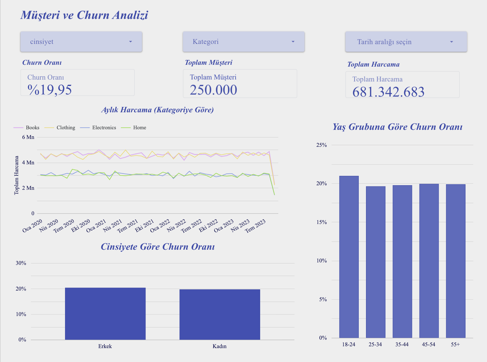
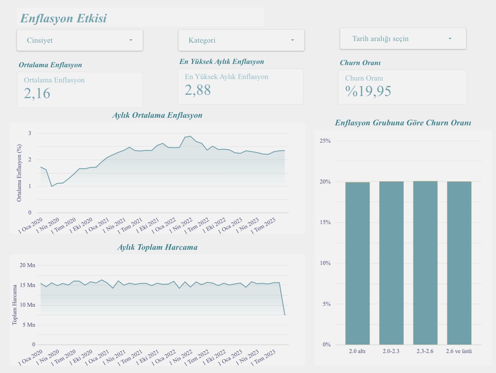
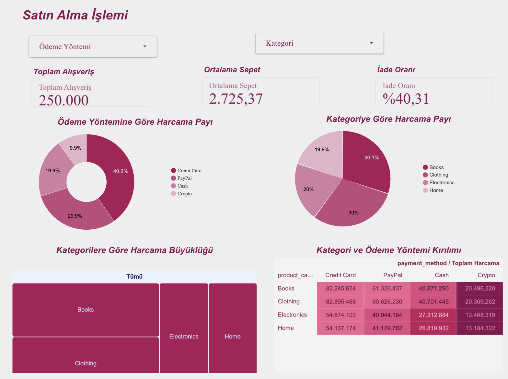

# E-Ticaret Churn Projesi: dbt Projesi

E-ticaret müşteri alışveriş verisini temizleyen, FRED enflasyon beklentisi verisiyle birleştirip analize hazırlayan dbt (DuckDB) projesi. Projenin genel açıklaması için [kök README](../README.md) dosyasına bakın.

Bu klasör projenin dbt kısmıdır. Ham CSV dosyaları DuckDB'ye yüklenir (`raw_` tabloları), dbt ile temizlenir (`stg_` modelleri) ve analize hazır tablolara dönüştürülür (`fct_` ve `dim_` modelleri).

Akış: `raw_ecom_churn` + `raw_inflation` → staging (`stg_`) → marts (`fct_` / `dim_`) → dashboard

## Veri kaynakları

| Kaynak | Dosya |
|---|---|
| E-ticaret müşteri verisi (250.000 alışveriş, 49.673 müşteri, Ocak 2020 - 15 Eylül 2023) | `data/ecomerce verisi.csv` |
| FRED günlük 10 yıllık enflasyon beklentisi, T10YIE (2.045 gün) | `data/fred enflasyon verisi.csv` |

Ham dosyalar `scripts/init_duckdb.py` ile `raw_ecom_churn` ve `raw_inflation` tablolarına yüklenir. Bu tablolar `models/staging/src_ecom.yml` içinde kaynak (source) olarak tanımlıdır.

## Model katmanları

Projede 6 model ve 9 veri testi vardır, testlerin hepsi geçer.

| Katman | Model | Ne yapar |
|---|---|---|
| staging | `stg_ecom_customers` | Ham müşteri verisini okur, sütunları anlamlı adlara ve doğru türlere çevirir |
| staging | `stg_daily_inflation` | Günlük enflasyon verisini tarihe çevirir, boş değerleri ayıklar, ay bilgisini üretir |
| staging | `stg_ecom_orders` | Ham veriden sipariş bilgilerini seçen sade model, `fct_customer_summary` tablosunu besler |
| marts | `fct_customer_churn` | Her satır bir alışveriş. Alışverişin yapıldığı ayın ortalama enflasyon beklentisiyle birleştirilir |
| marts | `dim_customers` | Her satır bir müşteri. RFM metrikleri, ortalama enflasyon maruziyeti ve churn bilgisi |
| marts | `fct_customer_summary` | Müşteri başına sipariş sayısı, toplam harcama ve ortalama sepet |

Staging ve mart katmanları ayrı klasörlerdedir: `models/staging`, `models/marts`.

## Çalıştırma

Önce repo ana klasöründe ham veriler DuckDB'ye yüklenir, sonra bu klasörde dbt çalıştırılır.

```
pip install dbt-duckdb
python scripts/init_duckdb.py   # repo ana klasöründe

cd nova_dbt
dbt run
dbt test
dbt docs generate
dbt docs serve
```

`profiles.yml` bağlantıyı `../nova.duckdb` dosyasına yönlendirir, bu yüzden dbt komutları `nova_dbt` klasöründe çalıştırılmalıdır. Üretilmiş dbt dokümantasyonu repoda [docs/dbt_docs.html](../docs/dbt_docs.html) dosyasındadır.

## Temizlik kararları

| Karar | Gerekçe |
|---|---|
| Sütun adları küçük harfli ve alt çizgili yapıldı (`Customer ID` → `customer_id`) | Tutarlı ve SQL'de kolay kullanılan adlar |
| Tarih ve sayı alanları doğru veri türlerine çevrildi | Ham dosyada her şey metin olarak okunabiliyor |
| Boş `Returns` değerleri iade yok (`is_returned = 0`) kabul edildi | 47.596 satırda boş, bilgi yok |
| `Age` sütunu kullanılmadı, yalnızca `Customer Age` alındı | İki sütun birebir aynı değerleri içeriyor |
| Günlük enflasyon aylık ortalamaya çevrildi | Alışverişle ay bazında eşleştirmek için (`round(avg(...), 3)`) |
| Enflasyon dosyasında `T10YIE` boş olan 84 gün ayıklandı | Değeri olmayan gün analize girmez |
| Churn oranı farklı müşteri sayısı üzerinden hesaplanır | Churn müşteri düzeyindedir, bir müşterinin tüm alışverişlerinde aynıdır |
| `Total Purchase Amount` olduğu gibi kullanıldı | `Product Price × Quantity` ile eşleşmiyor (250.000 satırın yalnızca 48'inde eşleşiyor), ama kaynak tutar budur |

Satır sayısı: 250.000 alışverişin hiçbiri çıkarılmadı. Müşteri sayısı 49.673, churn oranı %20,01 (9.942 müşteri).

## Testler

`dbt test` ile çalışır, projede toplam **9 test** vardır ve hepsi geçer.

| Model | Sütun | Test | Amaç |
|---|---|---|---|
| `fct_customer_churn` | `purchase_id` | unique, not_null | Her alışverişin tekil ve dolu bir numarası olması |
| `fct_customer_churn` | `customer_id` | not_null, relationships (`dim_customers`) | Her alışverişin var olan bir müşteriye bağlı olması |
| `fct_customer_churn` | `is_churn` | accepted_values (0, 1) | Churn değerinin yalnızca 0 veya 1 olması |
| `fct_customer_churn` | `monthly_inflation_rate` | not_null | Her alışverişin enflasyon değeriyle eşleşmesi |
| `dim_customers` | `customer_id` | unique, not_null | Her müşterinin tek satırda olması |
| `dim_customers` | `is_churn` | not_null | Churn bilgisinin eksik olmaması |

## Belgeler

| Belge | Kapsam | Hazırlayan |
|---|---|---|
| [VERI_SOZLUGU.md](VERI_SOZLUGU.md) | Ham tablolar, staging ve mart modellerinin tüm sütunları, testler, terimler | Ayşegül Esma Demircan |

Model ve sütun açıklamaları `dbt docs generate` ile de görülebilir.

## Dashboard (Looker Studio)

Rapor: [https://datastudio.google.com/reporting/6a04596f-32f7-4332-a4a5-c3d2792313ce](https://datastudio.google.com/reporting/6a04596f-32f7-4332-a4a5-c3d2792313ce)

### Araç seçimi
Dashboard için Looker Studio kullanıldı. Gerekçe: ücretsiz olması, tarayıcıdan çalışması ve tek bağlantıyla paylaşılabilmesi.

### Veri kaynakları
dbt tablolarından türetilen CSV dosyaları Looker Studio'ya yüklendi ve rapora veri kaynağı olarak bağlandı:

| Veri kaynağı | İçerik | Kullanım |
|---|---|---|
| `fct_customer_churn` | Alışveriş düzeyinde tablo (250.000 satır) | Churn grafikleri ve kartları |
| `mart_monthly_sales` | Ay ve kategori bazında alışveriş sayısı, müşteri sayısı, toplam tutar, iade sayısı, ortalama enflasyon | Aylık harcama ve enflasyon grafikleri |
| `mart_payment_category` | Ödeme yöntemi, kategori ve cinsiyet bazında alışveriş sayısı, tutar, iade | Satın alma davranışı sayfası |

`mart_monthly_sales` ve `mart_payment_category` dbt modeli değildir. `fct_customer_churn` tablosundan DuckDB sorgusuyla gruplanarak üretilmiş özet dosyalarıdır.

### Ortak alanlar
- `churn_orani_m` = `COUNT_DISTINCT(CASE WHEN is_churn = 1 THEN customer_id END) / COUNT_DISTINCT(customer_id)`, yüzde türünde. Alışveriş satırı bazında ortalama alınırsa oran %19,95 çıkar. Doğru müşteri bazlı oran %20,01'dir.
- `iade_orani` = `SUM(returns) / SUM(purchases)`, yüzde türünde (%40,31).
- `ortalama_sepet` = `SUM(total_amount) / SUM(purchases)` (2.725,37).
- `ay`: aylık grafiklerde x ekseni olarak kullanılan tarih alanı (`month_start` metninden üretilir).
- `enflasyon_grubu`: alışverişin yapıldığı aydaki enflasyona göre dört grup (2,0 altı, 2,0-2,3, 2,3-2,6, 2,6 ve üstü).
- `yas_grubu`: 18-24, 25-34, 35-44, 45-54, 55+.
- `cinsiyet`, `odeme_yontemi`, `kategori`: ham İngilizce değerlerin Türkçe karşılıkları (Kadın/Erkek, Kredi Kartı/PayPal/Nakit/Kripto, Kitap/Giyim/Elektronik/Ev).

### Rapor yapısı
Rapor üç sayfadan oluşur. Sayfalarda cinsiyet, kategori ve tarih aralığı filtreleri bulunur (sayfa 3'te ödeme yöntemi ve kategori).

1. **Müşteri ve Churn Analizi:** churn oranı (%20,01), toplam müşteri (49.673) ve toplam harcama (681.342.683) kartları; kategoriye göre aylık harcama çizgi grafiği; cinsiyete ve yaş grubuna göre churn oranı çubuk grafikleri.
2. **Enflasyon Etkisi:** ortalama enflasyon (2,16), en yüksek aylık enflasyon (2,88) ve churn oranı kartları; aylık ortalama enflasyon ve aylık toplam harcama çizgi grafikleri; enflasyon grubuna göre churn oranı. Churn grupların hepsinde yaklaşık %20'dir.
3. **Satın Alma Davranışı:** toplam alışveriş (250.000), ortalama sepet (2.725,37) ve iade oranı (%40,31) kartları; ödeme yöntemine ve kategoriye göre harcama payı grafikleri; kategori ve ödeme yöntemi kırılımı (ağaç haritası ve ısı haritalı pivot tablo).

**Sayfa 1: Müşteri ve Churn Analizi**



**Sayfa 2: Enflasyon Etkisi**



**Sayfa 3: Satın Alma Davranışı**



### Paylaşım
Bağlantıyı bilen herkes raporu görüntüleyebilir. CSV yüklenerek oluşturulan veri kaynakları nedeniyle raporun açılması için Google hesabıyla giriş yapmak gerekebilir.

### Bilinen sınırlar
- Veriler CSV anlık görüntüsüdür. dbt tabloları yenilenirse CSV'ler Looker Studio'ya yeniden yüklenmelidir.
- Dashboard'un özet CSV dosyaları dbt dışında üretildiği için repoda üretim betiği yoksa yeniden üretilemez.
- Eylül 2023 verisi ayın 15'ine kadardır, aylık toplamlarda son ay yarım görünür.
- Enflasyon göstergesi (FRED T10YIE) bir piyasa beklentisidir, tüketici fiyat endeksi değildir.
- Bulgular nedensellik değil, ilişki gösterir.

## Ekip ve görev dağılımı

| Kişi | Katkı |
|---|---|
| Mervegül Ölçek | DuckDB altyapısı, dbt projesinin kurulumu, analiz notebook |
| Aynur Çakıroğlu | Staging modelleri, veri temizleme, analiz notebook |
| Ayşegül Esma Demircan | Mart modelleri, dbt testleri, dbt dokümantasyonu, veri sözlüğü hazırlama |
| Esma Handan Tamer | Looker Studio dashboard, README dosyaları |

## Sınırlılıklar

- Enflasyon beklentisi piyasa göstergesidir ve müşterilerin yaşadığı fiyat artışını doğrudan ölçmez.
- `Total Purchase Amount`, `Product Price × Quantity` ile eşleşmez. Tutar kaynakta verildiği gibi kullanıldı.
- 47.596 alışverişin iade bilgisi boştur ve iade edilmedi sayıldı, gerçek iade oranı daha yüksek olabilir.
- Eylül 2023 yarım aydır.
- Testler yalnızca `fct_customer_churn` ve `dim_customers` için tanımlıdır. `stg_ecom_customers`, `stg_daily_inflation`, `stg_ecom_orders` ve `fct_customer_summary` için ayrı sütun testi yoktur.
- `dbt_project.yml` içinde şablondan kalan `example` ayarı vardır, projeye etkisi yoktur.